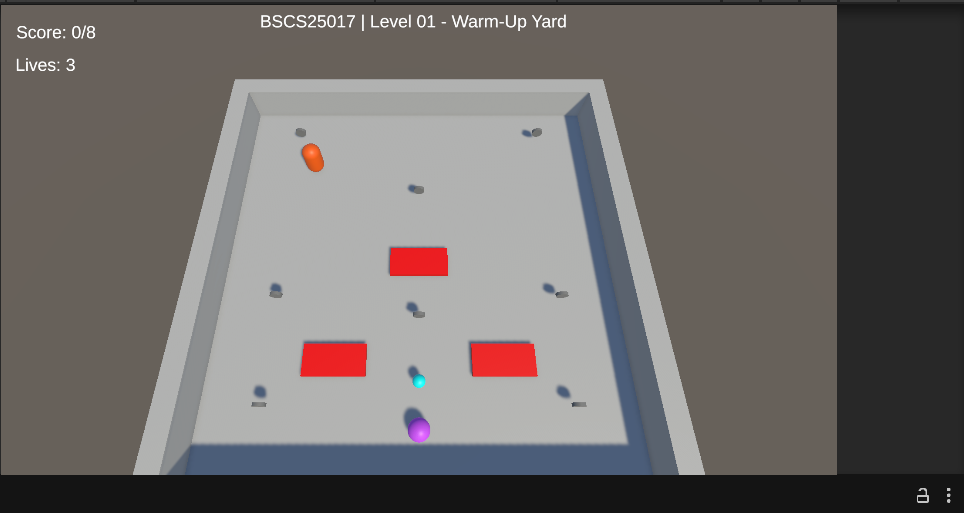
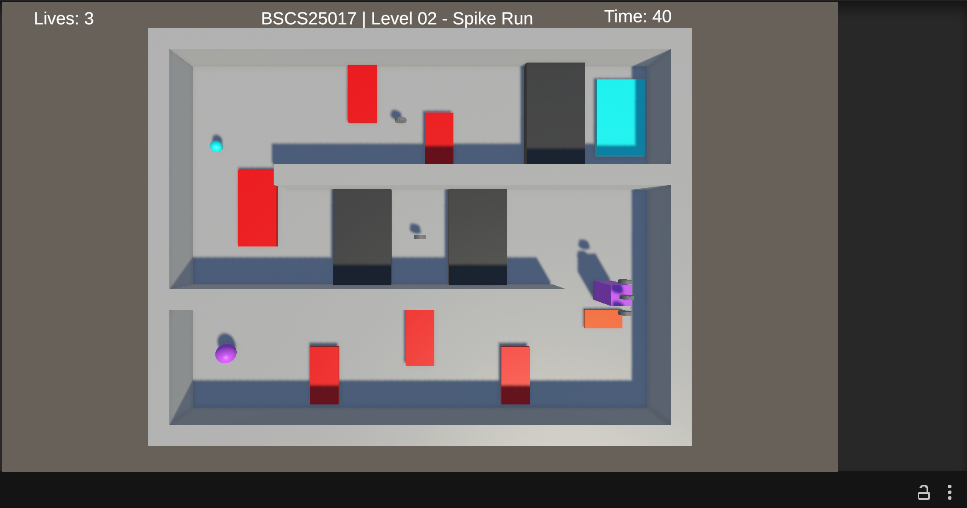
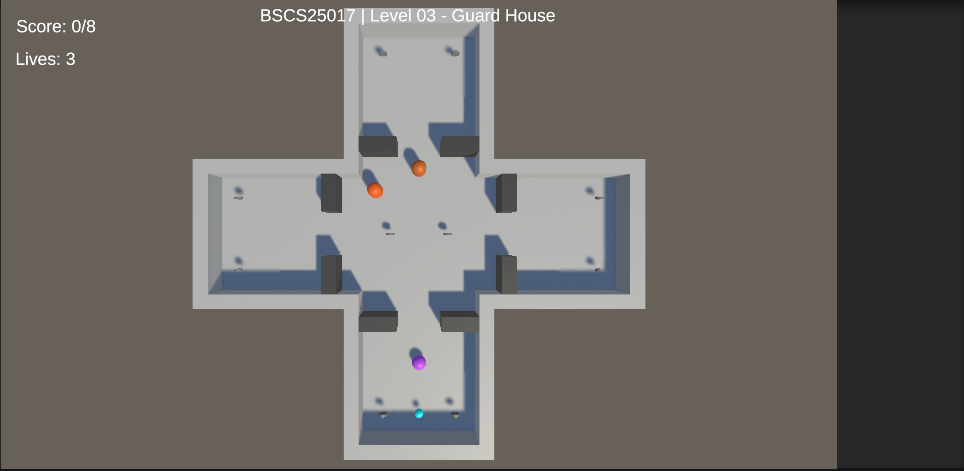
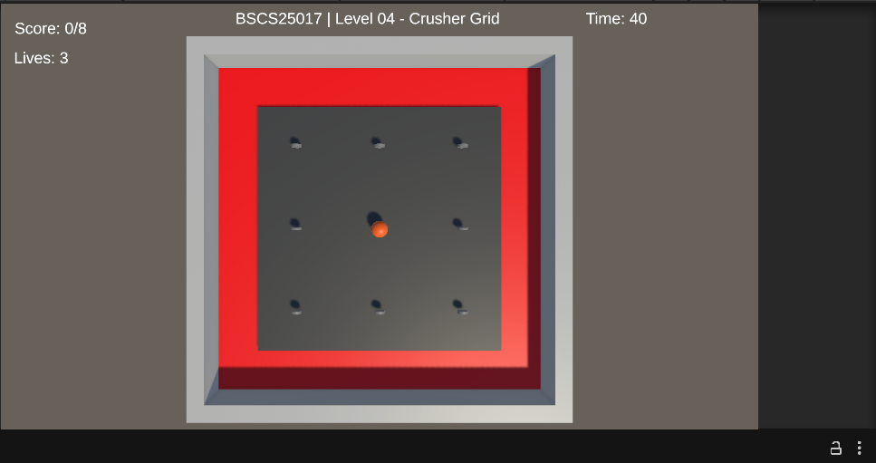
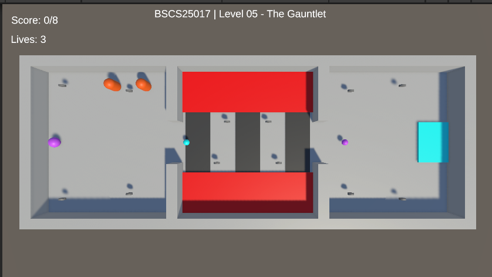

# CS464 Assignment 03 · Muhammad Abdullah · BSCS25017

- **Video (60–120 s):** https://drive.google.com/file/d/1R5p2wKqBxDwoiMldRccwpjL2CZT3rpNh/view?usp=drive_link
- **Started from:** A new project because there were major differences in both so to reduce the complexity starting from a new project was more suited.
- **Controls:** WASD or arrow keys; Restart / Next Level buttons on the panels
- **To win a level:** L1 collect 8 coins · L2 collect 5 coins then reach the goal · L3 collect 10 coins · L4 survive 40 s · L5 collect 12 coins, then reach the exit

## Levels
| Level | Screenshot | New idea | Combined with |
|---|---|---|---|
| Level01 |  | coins, score, a slow patrolling guard | spikes |
| Level02 |  | crushers with a warning, bounce pad, timer | coins and spikes |
| Level03 |  | guards that chase and give up | doors to hide behind |
| Level04 |  | a wave of crushers, survive mode | shield and magnet |
| Level05 |  | locked exit, 2 lives, chaser waves | fast guards, crushers |

## The numbers
| Number | Value | Why this value |
|---|---|---|
| Patrol speed | 2.5 m/s (L3), 3–4 m/s (L5) | well below my run speed, so I can always outrun a guard |
| Chase range | 6 m, give-up 8 m (L3) | a guard sees down its own corridor but not through door walls; the longer give-up range stops flicker |
| Knockback | 6, ForceMode.Impulse | one kick that throws me clear of the hazard; steering is off for 0.25 s |
| I-frames | 1 s | long enough to get clear after a hit, short enough that a hazard still hurts |
| Power-up duration | 5 s (speed x1.6) | long enough to cross a room, not long enough for the whole level |

## Short answers
**1. Why does a trigger need a Rigidbody on at least one of the two objects?**
In Unity trigger events fire when at least one of the two colliders is attached to a Rigidbody.If both colliders are plain Unity will not send a trigger.Because my player has a Rigidbody Unity sends trigger events for every collider my player touches, such, as coins, spikes or a kill zone.

**2. Which ForceMode do your knockback and your Part A force use, and why each?**
My Knockback uses Impulse. Impulse is a kick that is scaled by mass and is applied only once when the hit lands. In Level02 bounce pad uses VelocityChange. VelocityChange is an instant kick that ignores mass so the bounce is the same height every time.

**3. What does your code do when a second power-up is picked up while one is running?**
It refreshes: BoostSpeed stops the coroutine and starts a new one, with the full duration. The timer stays with the player. It continues even after the pickup is destroyed.

**4. Why can `==` fail as an arrival check, and when does it work?**
Floating-point positions rarely hit a target exactly. The equality operator `==` can stay false forever. The equality check only works after `MoveTowards` because `MoveTowards` snaps the Floating-point positions to the target on the final step. I use a distance check that relies on `arriveDistance`. I set arriveDistance to be larger, than one step.
